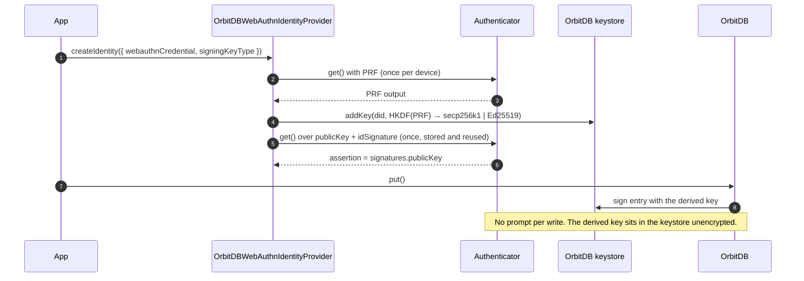
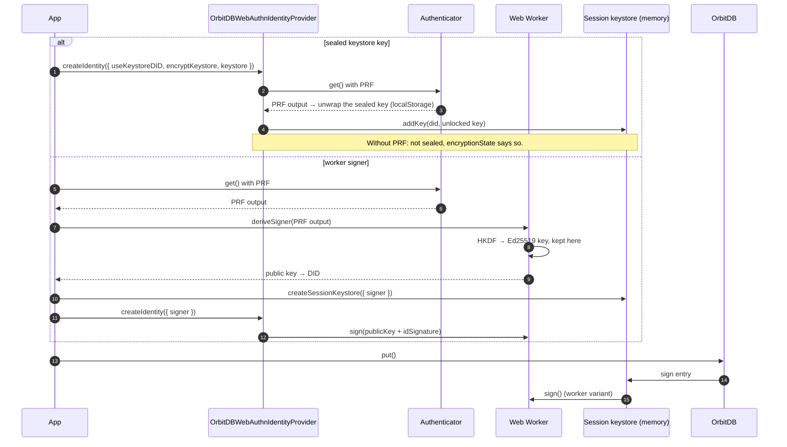
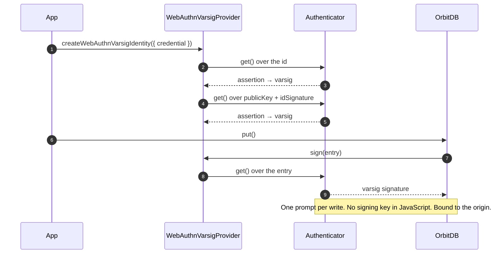
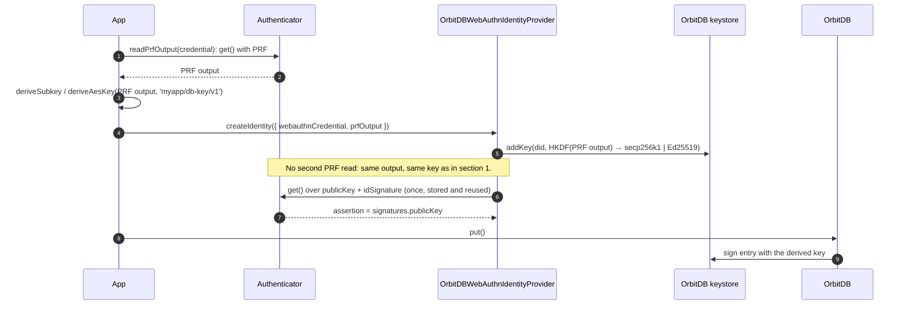
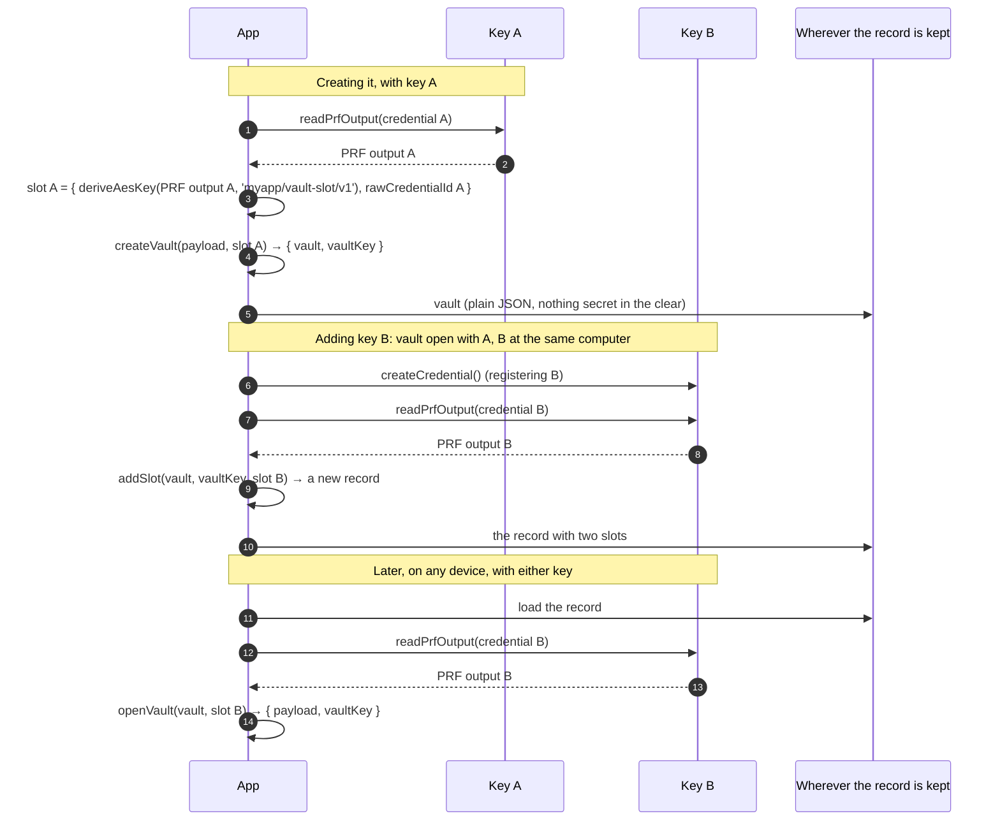
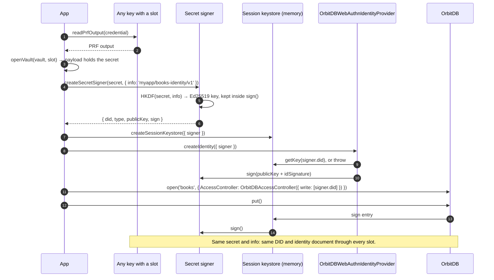

# Example sequences

One section per way of using the package. Sections 1 to 3 each name the
module that builds the identity for that option — the demos import it, and so
can you — and the browser suite that drives the demo through a real
authenticator (Chromium's virtual one in CI). Sections 4 to 6 are what an
application does around them, keys of its own and a second security key; no
demo shows them, so they name the suites that do.

The four scripted examples that used to live in `examples/*.js` are gone.
None of them ran: they read `window.location` in Node and `process.argv` in
the browser, one imported a function that did not exist, and no test ever
executed them. The sequences they described were also wrong about what
signs (see the README's option table).

## 1. Default path — passkey DID, a key derived from the passkey

Module: `examples/shared/lib/options/default-path.js` · Demo:
`examples/webauthn-todo-demo` · Suite: `tests/webauthn-default-path.test.js`

What a peer verifies: the assertion binds the DID's key to the derived key
(`verifyWebAuthnIdentityBinding`), then each entry's signature by that key.

## 2. Keystore DID, sealed by the passkey — or signed in a Web Worker

Module: `examples/shared/lib/options/encrypted-keystore.js` · Demo:
`examples/ed25519-encrypted-keystore-demo` · Suite:
`tests/ed25519-encrypted-keystore-e2e.test.js`

Both variants give OrbitDB `createSessionKeystore()`; with the default
keystore the unlocked key would be written to IndexedDB in clear.

What a peer verifies: the DID's key equals the identity's public key
(keystore-DID rule), then each entry's signature.

## 3. Varsig — the passkey signs every write

Module: `examples/shared/lib/options/varsig.js` · Demo:
`examples/webauthn-varsig-demo` · Suite: `tests/webauthn-varsig-e2e.test.js`

What a peer verifies: both identity varsigs against the key the DID
encodes (`verifyVarsigIdentity`), then each entry's varsig.

## 4. One touch — the application's keys and the identity from one PRF read

Suites: `tests/prf-keys.test.js` (mock authenticator),
`tests/vault-two-authenticators.test.js` (Chromium)

The default path (section 1) with an application that keeps data under keys
of its own. It reads the PRF output once, derives its keys from it, and hands
the same output to the provider, which derives the signing key from it
instead of asking the passkey a second time.

`readPrfOutput` has to ask what the provider would ask — the credential's own
PRF input — so call it without a `prfInput` of your own. The provider uses
`prfOutput` only while the keystore holds no key for the DID; once it does,
the output is not needed, and the provider drops its reference. So the saving
is one prompt, the first time an identity is created on a device; in later
sessions the application's own read is the only prompt.

What a peer verifies: the same as in section 1. The identity cannot be told
apart from one whose provider read the PRF output itself.

## 5. A vault, and a second security key

Suites: `tests/vault.test.js` (Node), `tests/vault-two-authenticators.test.js`
(Chromium, two virtual authenticators, each with its own PRF secret),
`tests/vault-keeper.test.js` (Node)

A key derived from one passkey exists only where that passkey is: a second
security key has its own PRF secret and derives other keys. A vault holds what
both have to reach, sealed under a random vault key, and gives each key a slot
that unseals the vault key.

Each unlock is one touch, and with the same output handed to the provider as
`prfOutput` (section 4) that touch also gives the key's OrbitDB identity.

`createVaultKeeper({ storage, key, slotInfo })` does this around a store:
`keeper.open({ prfOutput, rawCredentialId, create, find })` opens the vault
this key has a slot in, takes one from `find` (a backup, say), or makes a new
one holding `create()`; `keeper.addPasskey(opened, { prfOutput,
rawCredentialId })` is `addSlot` for the next key. See
[Keeping vaults](API.md#keeping-vaults-createvaultkeeper-storage-key-slotinfo-).

What a peer verifies: nothing new. The vault is not an identity, and each key
keeps its own DID and signing key: key A and key B are two writers. For one
identity both keys write as, see section 6.

## 6. An identity that is nobody's passkey

Suite: `tests/secret-signer.test.js` (Node, two OrbitDB peers)

OrbitDB fixes who may grant write access when a database is created, so a
database rooted at key A's identity stays key A's. The application keeps a
random secret in the vault (section 5) and turns it into a signer; every key
that opens the vault then writes as the same identity.

No `webauthnCredential` is needed, and the provider asks no passkey: the only
prompt is the PRF read that opens the vault. Other people are not given the
secret; they are granted write access under their own identities
(`db.access.grant('write', did)`), which can be revoked. The root cannot be.

What a peer verifies: the keystore-DID rule, as in section 2 — the DID's key
equals the identity's public key — then each entry's signature.

## Prompt counts

|                 | Create                                 | First authenticate     | Later sessions             | Per write |
| --------------- | -------------------------------------- | ---------------------- | -------------------------- | --------- |
| Default         | 1 (+1 largeBlob write where supported) | 2                      | 0                          | 0         |
| One touch       | 1                                      | 2 (PRF read, identity) | 1 (the application's read) | 0         |
| Sealed keystore | 1 (+1)                                 | 2 (seal, unlock)       | 1                          | 0         |
| Worker signer   | 1 (+1)                                 | 1                      | 1                          | 0         |
| Varsig          | 1 (+1)                                 | 2                      | 2                          | 1         |

The demos count these at the WebAuthn API (`examples/shared/lib/prompt-counter.js`)
and the suites assert them — except the one-touch row, which no demo shows.
For it, `tests/prf-keys.test.js` asserts that the signing key costs no
assertion beyond the application's own read, and
`tests/vault-two-authenticators.test.js` that opening the vault and deriving
the signing key are one touch. Without `prfOutput`, the same application would
need 3 at first authenticate: its own read, the provider's, the identity. An
identity from `createSecretSigner` (section 6) adds no prompt to the read that
opens the vault.

What the **(+1)** at creation is, checked against the demos:

- **Default** — a `largeBlob` write of the identity metadata. It can store
  where the authenticator supports `largeBlob`, since registration asks for it
  (`preferred`). The demo reads `written` and warns where the authenticator
  declined, since a declined write throws nothing.
- **Varsig** — the same write, read the same way.
- **Sealed keystore, worker signer** — the encrypted-keystore demo makes no
  `largeBlob` write at creation at all, so these two `(+1)` do not match its
  code. Either the counts or the demo is out of date; this page does not know
  which.
